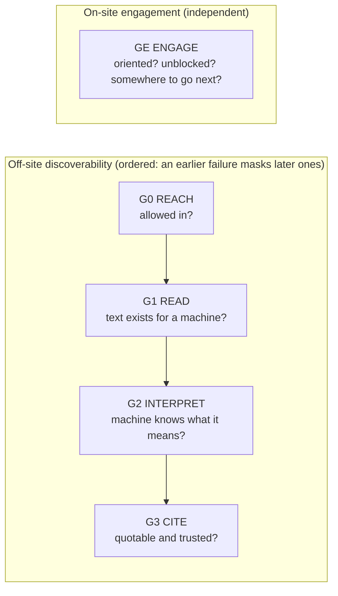
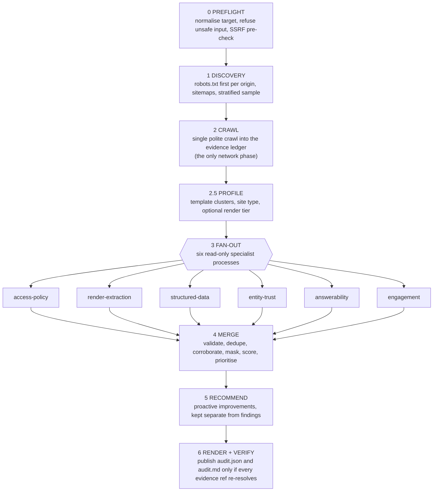

# Brand AI-Readiness Audit

**An Agent Skill Marketplace that lets a general-purpose LLM agent audit any website for two
things: why the site is missing from, or misrepresented in, AI assistants such as ChatGPT,
Perplexity and Gemini, and why visitors who do arrive from them leave.**

Point an agent (for example Claude Code) at a URL. The marketplace crawls a stratified sample
of the site politely, runs six independent specialist auditors over the stored evidence, and
merges their output into one verified report: problems with evidence and computed severity,
plus prioritized fixes that say how to confirm they worked. It is **read-only and
recommend-only**. It never changes the site it audits.

> **Adobe University Hackathon 2026: Round 4 Finalist (top 45 of 100,000+ teams).**
> Designed and built by [Achyuth A](https://www.linkedin.com/in/achyuth2005/), [Aditya Chauhan] (https://github.com/adityac7002) and
> [Aditya Prabhakar](https://github.com/aditya-prabhakar-13) (IIT Guwahati).
> This is an independent student project. It is not affiliated with or endorsed by Adobe.


---

## Contents

1. [Why this exists](#1-why-this-exists)
2. [Highlights](#2-highlights)
3. [Architecture](#3-architecture)
4. [The seven skills](#4-the-seven-skills)
5. [Quick start](#5-quick-start)
6. [Using it from an LLM agent](#6-using-it-from-an-llm-agent)
7. [What the report looks like](#7-what-the-report-looks-like)
8. [Engineering decisions](#8-engineering-decisions)
9. [Safety model](#9-safety-model)
10. [Testing and evaluation](#10-testing-and-evaluation)
11. [Known limitations](#11-known-limitations)
12. [Repository layout](#12-repository-layout)
13. [Further reading](#13-further-reading)

---

## 1. Why this exists

AI assistants now answer questions that used to send people to a search results page. To be
cited in those answers, a page has to clear a chain of mechanical hurdles. Its crawler must
be **allowed in**, the text must **exist in the HTML** rather than only after JavaScript runs,
a machine must be able to **interpret** what the facts mean, and a passage must be
**quotable on its own** and trustworthy. Each failure is silent: the site looks fine in a
browser, but the brand quietly disappears from AI answers.

Once a visitor does arrive, often deep inside the site with no context, a second set of
problems decides whether they stay: blocking overlays, no orientation, dead ends.

This project encodes both halves as deterministic, evidence-backed checks that any agent can
run. It reasons from how these systems work, not from a list of example sites.

## 2. Highlights

- **7 skills in the open [agentskills.io](https://agentskills.io) format:** one entrypoint
  orchestrator and six specialists, tied together by [`marketplace.json`](marketplace.json).
- **120 checks** in a closed registry ([`lib/auditkit/checks.py`](lib/auditkit/checks.py)).
  Each skill's documentation table is generated from that registry, so docs cannot drift from
  code.
- **A gate model with root-cause attribution.** A finding is reported at the gate where its
  cause lives. Downstream symptoms of one upstream fault are *masked* rather than counted
  twice.
- **Computed, not hand-assigned, severity:** `gate × scope × fact class × confidence`, with
  published caps. Every report shows the derivation string for every finding.
- **Anti-hallucination by construction.** Every finding cites evidence in a hash-addressed
  ledger. The report is published only if every evidence reference re-resolves, so the
  verification gate fails closed.
- **Deterministic.** Re-analysing a stored crawl produces a byte-identical report.
- **Safe crawling:** SSRF defence with redirect re-validation, an RFC 9309 robots.txt matcher,
  rate limiting and a circuit breaker, a mutating-GET denylist, and honest user-agents that
  never impersonate another crawler.
- **Minimal dependencies.** The network gateway, robots.txt matcher, rate limiter and evidence
  ledger use only the Python standard library. No ML packages, no OCR, and nothing downloaded
  at runtime.

## 3. Architecture

### The gate model

To be cited, a page must be let in, then read, then interpreted, then quoted and trusted,
in that order. Engagement runs in parallel, because it only matters once a human has arrived.



### The pipeline



**Composition, by example.** Suppose a product template renders its content client-side.
A naive auditor reports missing structured data, boilerplate-dominated pages, a missing main
landmark and more. All of that is true of the raw HTML, and all of it has one cause. This
marketplace reports **one critical finding**, "product content is assembled client-side and
absent from the HTML response", quoting the missing prose from the page's own hydration
payload. It lists the rest as masked findings that will resolve once the cause is fixed. When
two skills see the same fault, it becomes one finding with `corroborated_by` and raised
confidence.

A specialist that crashes or times out does not fail the audit. It is recorded in
`coverage.skills_failed`, its gate becomes `not_assessed`, and the report says so.

## 4. The seven skills

| Skill | Gate | Evidence it reads | What it detects | Checks |
| :--- | :--- | :--- | :--- | :---: |
| [`ai-readiness-audit`](skills/ai-readiness-audit) (entrypoint) | all | — | orchestration, the single crawl, merge, recommendations, the final verified report | — |
| [`access-policy-audit`](skills/access-policy-audit) | G0 | HTTP, robots.txt, sitemaps, directives | per-AI-crawler blocks, `noindex`/`nosnippet`, bot gating, auth walls, soft 404s, duplicate hosts, sitemap health | 26 |
| [`render-extraction-audit`](skills/render-extraction-audit) | G1 | raw vs. rendered text, media | client-side render gaps in three tiers (no browser required); facts locked in images, SVG, PDFs, iframes, video | 12 |
| [`structured-data-audit`](skills/structured-data-audit) | G2 | JSON-LD, Microdata, RDFa | an eight-rung validity ladder, profile-conditional coverage, entity-graph linkage, markup that contradicts the page | 24 |
| [`entity-trust-audit`](skills/entity-trust-audit) | G2–G3 | naming surfaces, identifiers, dates | entity disambiguation, name consistency, `sameAs` resolution, contradictory or deploy-stamped dates, corroboration surface | 15 |
| [`answerability-audit`](skills/answerability-audit) | G3 | the form of the prose | passages that lose their subject when retrieved alone, no definitional sentence, buried answers, unaddressable sections | 9 |
| [`engagement-audit`](skills/engagement-audit) | GE | interaction surface, link graph | orientation for a deep arrival, blocking overlays and walls, dead ends and orphans, conversion path, readability | 34 |

Each specialist owns one evidence domain, runs standalone on a stored ledger, and never
imports another specialist. Shared code lives in [`lib/auditkit`](lib/auditkit).

## 5. Quick start

```bash
git clone https://github.com/achyuth2005/brand-ai-readiness-audit.git
cd brand-ai-readiness-audit
python3 -m venv .venv && source .venv/bin/activate
pip install -r requirements.txt

# Live audit (writes audit.json + audit.md to ./audit-output)
python skills/ai-readiness-audit/scripts/run_audit.py --url example.com \
    --out ./audit-output --contact you@example.com
```

`--contact` puts your email or URL into the crawler's user-agent, so a site operator can
reach whoever is running the audit. Set it to your own address. You can also set it with
the `AUDIT_CONTACT` environment variable.

**More options**

```bash
# Tune the crawl
python skills/ai-readiness-audit/scripts/run_audit.py --url https://example.com --out ./out \
    [--max-pages 30] [--budget-seconds 240] [--render auto|on|off] [--offsite on|off] \
    [--no-evidence] [--json-only]

# Offline re-analysis of a stored crawl (no network; byte-identical output)
python skills/ai-readiness-audit/scripts/run_audit.py --ledger ./out/ledger --out ./reanalysis

# Run one specialist on its own
python skills/structured-data-audit/scripts/analyze_structured_data.py \
    --ledger ./out/ledger --out ./sd-findings.json
```

**Optional render tier:** `pip install playwright && playwright install chromium`. Without
it, client-side rendering is still detected from hydration payloads.

| Output | Contents |
| :--- | :--- |
| `audit.json` | the verified report (validated against [`schema/audit-report.schema.json`](schema/audit-report.schema.json)) |
| `audit.md` | the same report for a non-expert: summary, scorecard, first five actions, and each problem with evidence, why it matters, fix steps and how to confirm the fix |
| `ledger/` | the evidence every finding cites |
| `requests.log` | every request made, with method, status and purpose |
| `run.log` | phase timings and decisions |

**Exit codes:** `0` report written (findings are not failures) · `2` verification failed, so
nothing is published · `3` unsafe target refused · `4` target unreachable · `5` time budget
closed before minimum coverage · `6` a required package is missing. A site that refuses every
page still gets a report: the refusal is the finding.

## 6. Using it from an LLM agent

Every skill folder is a standard Agent Skill: a `SKILL.md` with YAML frontmatter, plus
`scripts/` and `references/` for progressive disclosure. Any agent harness that supports
Agent Skills can load the marketplace and invoke the entrypoint:

```text
Use the ai-readiness-audit skill to audit https://example.com and summarise the top five fixes.
```

The entrypoint's `SKILL.md` gives the agent a numbered, deterministic procedure. The scripts
do the measuring, and the agent explains the report and checks the evidence. The agent never
invents findings: every finding in the report comes from a check, and every check cites
stored bytes.

## 7. What the report looks like

Abridged and illustrative. The required fields come from the challenge schema, and the extra
fields are this engine's.

```json
{
  "site": "example.com",
  "audited_at": "2026-09-20T14:32:00Z",
  "summary": { "total_findings": 14, "critical": 1, "high": 2, "medium": 6, "low": 5, "masked": 2 },
  "findings": [
    {
      "id": "F-001",
      "title": "robots.txt disallows an AI assistant's retrieval crawler",
      "severity": "critical",
      "evidence": "robots.txt line 12: 'User-agent: OAI-SearchBot' / 'Disallow: /' applies to 30/30 sampled pages.",
      "suggested_action": { "summary": "Allow the retrieval crawler on public content.", "priority": "critical" },
      "check_id": "G0.ROBOTS.AI_AGENT_BLOCKED",
      "gate": "G0",
      "confidence": "high",
      "detected_by": "access-policy-audit",
      "severity_derivation": "G0 gate 1.00 x site scope 1.00 x primary fact 1.00 x high confidence 1.00 = 1.000 -> critical",
      "evidence_refs": [{ "kind": "file_line", "url_hash": "…", "path": "/robots.txt", "line": 12 }]
    }
  ],
  "masked_findings": ["…"],
  "action_plan": ["…"],
  "gate_scorecard": {"…": "…"},
  "proactive_recommendations": ["…"],
  "coverage": {"…": "…"},
  "methodology": {"…": "…"}
}
```

## 8. Engineering decisions

| Decision | Why |
| :--- | :--- |
| **One crawl, many readers.** Only the orchestrator touches the network. Specialists read the immutable evidence ledger in separate, read-only processes. | Politeness to the audited site, reproducibility, and isolation: a buggy analyzer cannot make requests. |
| **Severity is computed, never hand-set.** | The same fault gets the same severity on every site, and anyone can recompute it from the report. |
| **Dominance masking instead of deduplication alone.** | Ten symptoms of one cause should read as one fix, without hiding the symptoms. |
| **A verification gate before publishing.** | A report with a dangling evidence reference is withheld (exit `2`) rather than shipped. |
| **Standard library first.** | No `requests`: the gateway pins resolved addresses through `http.client` to defeat DNS-rebinding SSRF. No `tldextract`: it downloads data at runtime, which would break determinism. |
| **Rejected splits.** There are no separate alt-text, robots/sitemap, severity or report-writer skills. | A split must have its own evidence domain, independent utility, its own fix owner, and swappability. Anything else is padding. |
| **Thresholds live in config with rationales.** | [`config/thresholds.json`](config/thresholds.json) records every number with its reason, and a test enforces that the code reads no undeclared threshold. |

## 9. Safety model

| Concern | Control |
| :--- | :--- |
| Mutation | Only `GET`/`HEAD`. A denylist refuses logout, unsubscribe, cart, checkout and admin paths, plus action-verb query parameters and single-use tokens. |
| SSRF | Private, loopback and link-local ranges are refused. Every redirect hop is re-validated. Resolved addresses are pinned. |
| robots.txt | Fetched first for every origin and matched per RFC 9309. A disallowed path is never fetched. |
| Load | Per-origin pacing, `Crawl-delay` honoured, size and decompression-bomb caps, and a circuit breaker. |
| Identity | An honest user-agent with a contact address. It never impersonates another crawler. |
| Personal data | Evidence redacts emails, phones, card numbers and IBANs, and the finished report is scanned for credential patterns before it is written. |

## 10. Testing and evaluation

```bash
tests/run_tests.sh      # offline: standard-library unittest, no network
```

**115 tests pass** on Python 3.9–3.13. The tests cover:

- **Safety:** the method allowlist, SSRF ranges, robots.txt precedence, size caps, the
  read-only ledger, and that only the gateway modules import networking.
- **Detectors and negative controls:** every check fires on its positive fixture, and a
  well-built site produces zero findings. Each false-positive guard was added after a real
  false positive during calibration.
- **Dominance masking**, the **schema and manifest** (exactly one entrypoint, spec-compliant
  skills), **determinism** (two runs over one frozen ledger produce byte-identical reports),
  **config** (every threshold declared), and **generalization** (no site-specific hosts in
  detection code).

**Calibration (before submission).** The engine was run live against 29 public sites:
e-commerce, publishers, SaaS, documentation, local businesses, government and
client-rendered apps. Every critical and high finding was checked against the stored
responses: of 70 labelled findings, 39 false positives and 12 overstated severities were each
fixed with a generic guard and a negative-control test, never a site-specific rule.

**Out-of-sample sweep (after submission, unchanged engine).** The engine was then run against
47 sites it had never seen, including 12 Indian brands, non-English publishers, SPAs,
bot-walled sites and 5 malformed-input variants:

| Measure | Result |
| :--- | :--- |
| Verified report published | 36/47 (77%) |
| Report withheld by the verification gate (fails closed) | 8/47 (17%), mostly one evidence-pairing bug, documented below |
| Unreachable | 3/47 (robots.txt timeouts; one server sending more than 100 headers) |
| Determinism: offline re-analysis of each stored crawl | 36/36 byte-identical |
| Live vs. offline (check, severity) sets | 36/36 identical |
| Runtime | median 85 s, max 278 s (a site requesting a crawl delay) |
| Input variants (bare domain, `http://`, uppercase, deep path, query string) | 5/5 normalised correctly |
| Hand-labelled critical/high findings that were correct or real-but-overstated | 36/55 (65%) |

The precision figure is reported because it is the honest measure of a heuristic auditor on
unseen sites. Most of the false criticals come from one check (`data-nosnippet`; see
limitations). Checks such as AI-crawler robots.txt blocks were right every time (10/10).

## 11. Known limitations

- **Sampled, not exhaustive.** Up to 30 pages by default. Template clustering attributes a
  sampled defect to its template, and every finding states its k/n.
- **Static-first.** Browser measurement needs Playwright, and the report states the render
  mode used.
- **Heuristic content checks are English-only.** Other languages are skipped and reported.
- **It measures mechanisms, not assistant answers.** No check claims to predict whether a
  given assistant will cite the site.
- **Known issues in the submitted version**, kept unchanged for hackathon integrity:
  - `data-nosnippet` on small regions can be over-graded to critical.
  - A verification-gate bug withholds reports on some large sites (exit `2`). The findings
    are still written to `work/`, and an agent can present them clearly labelled as
    unverified.

## 12. Repository layout

```text
brand-ai-readiness-audit/
├── marketplace.json            # skill manifest: 7 skills, exactly one entrypoint
├── skills/
│   ├── ai-readiness-audit/     # entrypoint: preflight, crawl, fan-out, merge, report, verify
│   ├── access-policy-audit/    # G0 reach
│   ├── render-extraction-audit/# G1 read
│   ├── structured-data-audit/  # G2 interpret
│   ├── entity-trust-audit/     # G2-G3 identity and time
│   ├── answerability-audit/    # G3 cite
│   └── engagement-audit/       # GE engage
│       └── (each: SKILL.md, scripts/, references/)
├── lib/auditkit/               # shared engine: gateway, ledger, check registry, severity, merge
├── schema/                     # JSON Schemas: report, finding, ledger entry, site profile
├── config/thresholds.json      # every threshold, each with a written rationale
├── tests/                      # 115 offline tests + fixtures
├── DESIGN.md                   # full design document (the original submission README)
└── requirements.txt
```

## 13. Further reading

- [`DESIGN.md`](DESIGN.md): the complete design document, covering failure-mode coverage, the
  evidence model, proactive recommendations, generalization strategy and rubric mapping.
- [`skills/ai-readiness-audit/references/`](skills/ai-readiness-audit/references): the gate
  model, severity model and composition rules.

## License

[MIT](LICENSE)
